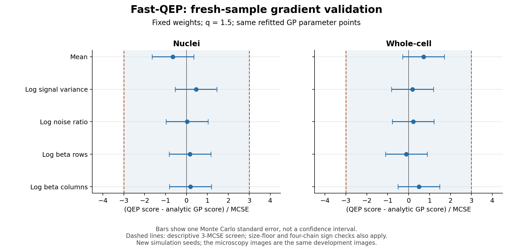

# Fast-QEP checkpoint — 2026-10-15

This checkpoint continues `fa746853ba007552bb1d5a43340d91f6796096b1`
(Rounds 1–10) on `chatgpt-review-cellseg-20260917`. It archives the supplied
Fast-QEP execution sources, the Mac end-to-end review, and the subsequent
hyperparameter-score work. It does not start another experiment.

## 当前状态

- 固定参数 Fast-QEP q=1.5 接原版 R 下游，主结果与 Fast-GP 的 AP50 相同：
  nuclei 0.6481013、whole-cell 0.5838641。不能挑选单条链声称 QEP 改善。
- 完成原始首块的解析 GP 重拟合与 QEP 边际似然梯度诊断；没有进行 QEP 参数更新。
- 离线诊断发现固定控制变量权重可能增大方差，随后冻结修正权重并用新种子验证。
- 新种子验证的数值、收敛及精度修复检查均通过，但仍无符合预定规则的局部学习方向。
  两个数据集的最大 `|QEP score − GP score| / MCSE` 分别为 0.6475、0.7125，
  均未达到 3；十个坐标的四链方向也均未一致。
- 根据冻结停止规则，暂停这条局部梯度训练分支，不自动扩展到完整优化、延长采样或改阈值。
  这不等于证明所有 Fast-QEP 模型无效，也不等于梯度严格为零。

这些都是已使用的 development 图像。新 MCMC 种子不代表独立测试图像。
最近三个梯度阶段没有产生新分割结果，也没有改变此前 AP。

## Evidence and directory map

| Stage | Location | Executed result |
|---|---|---|
| Fixed-parameter original-R end-to-end run | [Mac report](fastqep_e2e_review_20261015/REPORT.md), [metrics](fastqep_e2e_review_20261015/metrics.csv), [audit](fastqep_e2e_audit_20261015/FastQEP_end_to_end_audit_20261015.pdf) | 25 tiles pass numerical gates; pooled QEP and GP AP50/AP75 tie; no stable QEP gain |
| Hyperparameter derivation and checks | [Feasibility PDF](fastqep_hyperfit_review_20261015/FastQEP_hyperparameter_feasibility_20261015.pdf) | Mathematical/numerical checks completed; its proposed outer optimization loop was **not executed** |
| GP refit and QEP score pilot | [Pilot report](fastqep_hyperfit_pilot_analysis_20261015/REPORT_EN.txt), [raw outputs](FastQEP_hyperfit_pilot_20261015/payload/results/fast_qep_hyperfit_pilot_20261015) | Two first tiles, archived-R and GP-refitted parameters; four targets pass; no resolved coordinate direction |
| Offline control-variate diagnostic | [Offline report](fastqep_score_precision_diagnostic_20261015/REPORT_EN.txt) | Reused old draws; bounded scalar weights; an estimator diagnostic, not independent confirmation |
| Frozen-weight fresh-seed validation | [Latest report](fastqep_fresh_validation_review_20261015/REPORT_EN.txt), [中文说明](fastqep_fresh_validation_review_20261015/README_CN.txt), [raw outputs](fastqep_score_precision_diagnostic_20261015/fresh_validation) | Both precision checks pass; no eligible local learning direction; frozen stopping rule applies |



The runnable source is in
[`FastQEP_hyperfit_pilot_20261015`](FastQEP_hyperfit_pilot_20261015).
Its `payload/` contains the exact original Fast-QEP sampler, Fast-GP code,
real-R downstream scripts, two input images, fixed reference anchors, and the
new score implementation. Its original 69-file source manifest is unchanged.
The 53 frozen payload files from the original execution package remain unchanged.

## Model and claim boundaries

The tested replacement is a full, finite-tile covariance-matched q-exponential
prior with independent Gaussian observation noise, separable Matérn-5/2
Kronecker structure, and q=1.5 against the analytic q=2 GP control.
Its contract is in
[`MODEL_CONTRACT.md`](FastQEP_hyperfit_pilot_20261015/payload/audits/fast_qep_paper_alignment_20261014/MODEL_CONTRACT.md).
Do not equate it automatically with an arbitrary-grid joint QEP process, or
with the earlier shallow ExactQEP likelihood construction from Rounds 4/9.

The estimator precision improvement is reproducible under new randomness.
The fresh validation found no supported coordinatewise QEP learning direction
at the two tested GP-fitted parameter points and current Monte Carlo precision.
This is neither an equivalence test nor a proof against other optima, joint
directions, kernels, or QEP models. No nuisance ECM candidate was applied.

## What is fully archived, and what is not

The source bundle, GP-refit/score pilot, offline inputs and analysis, fresh
validation, score traces, saved initial/final states, reconstruction estimates,
protocols, diagnostics and reports are included as unpacked files. Original
bytes and internal relative paths are preserved; redundant delivery ZIPs,
Python caches and PDF preview rasters are omitted. The small R reference
fixture ZIP is retained because it is part of the frozen execution inputs.

The uploaded Mac review is a **lightweight subset**, not a full Mac backup.
All 75 supplied files are included; 72 match entries in its completion manifest.
That manifest also names 214 unsupplied artifacts (including full-image arrays,
sampler state and R intermediates). Their names and hashes are recorded in
[`mac_artifact_availability.json`](mac_artifact_availability.json).
The existing Mac AP audit checks supplied reports; it did not independently
rescore unavailable full-image arrays. The archived execution source provides
the route to regenerate them in the recorded R environment.

The September 24 files embedded as historical anchors are only the metrics,
manifest and fixed anchor arrays required by this execution bundle. This
checkpoint does not assert that every intervening chat attachment or all files
on the Mac have been recovered. Original R and DeepQEP repositories remain
separate references; no complete reference repository is vendored here.

## Verify and review without another experiment

From this directory:

```bash
python verify_checkpoint.py
python review_saved_results.py
python fastqep_score_precision_diagnostic_20261015/validate_new_samples.py
```

The first command checks hashes and availability. The second recomputes the
offline summaries and audits saved scores in a temporary directory, compares
them with the frozen reports, and leaves the archived files unchanged.
The third checks the relocated source, original R anchors, frozen weights and
GP parameter points; without `--run` it does not sample or fit.
Its historical `READY_NOT_RUN` message means that invocation performed checks
only, not that the archived fresh validation was never completed.

Hash verification needs only Python's standard library. Saved-score review
needs NumPy and SciPy; the source/anchor check additionally needs Pillow and
threadpoolctl. The recorded pilot used Python 3.12.14, NumPy 2.3.5,
SciPy 1.17.0, Pillow 12.3.0 and threadpoolctl 3.6.0, single BLAS thread.
See the preserved `environment.json` files for actual run provenance.
No installation or new experiment occurs during checkpoint verification.

Historical `NOT_RUN`, `CANDIDATE`, approval language, absolute paths and ZIP
layout instructions inside frozen documents record their original preparation
state. They are retained verbatim to preserve their hashes. The current outcome
is the completed fresh validation and its latest report above; the commands in
this README describe the unpacked Git layout. Delivery manifests referencing
`source/*.zip` describe the earlier downloadable packages; the corresponding
sources are now unpacked. `SOURCE_INVENTORY.json` retains those archive hashes.

## Explicit reproduction commands (not run by verification)

Use new output paths; the scripts refuse to overwrite completed results.
These commands document reproduction of completed protocols. Further scientific
expansion remains paused and requires a newly justified, approved protocol.

```bash
# Reproduce the completed first-tile pilot, if intentionally requested:
python FastQEP_hyperfit_pilot_20261015/run.py --pilot --out /tmp/fastqep_pilot_reproduction

# Reproduce the completed fresh validation with exactly the frozen old weights:
python fastqep_score_precision_diagnostic_20261015/validate_new_samples.py \
  --run --out /tmp/fastqep_fresh_reproduction

# Mac end-to-end reproduction requires actual R packages and the R reference repo:
python FastQEP_hyperfit_pilot_20261015/run_original_e2e.py --run \
  --reference /path/to/cell_segmentation_original
```

The original R reference commit is `44714c2e0be958fe796a8fd4bdbc220dae3c23dd`.
Follow the frozen end-to-end README for the recorded package versions and
preflight requirements. The Mac review folder is separate from the executable
bundle's output path, so it cannot be overwritten by those commands.

`CHECKPOINT_MANIFEST.json` is the inventory for this Git layout.
`SOURCE_INVENTORY.json` identifies source packages and intentional omissions.
